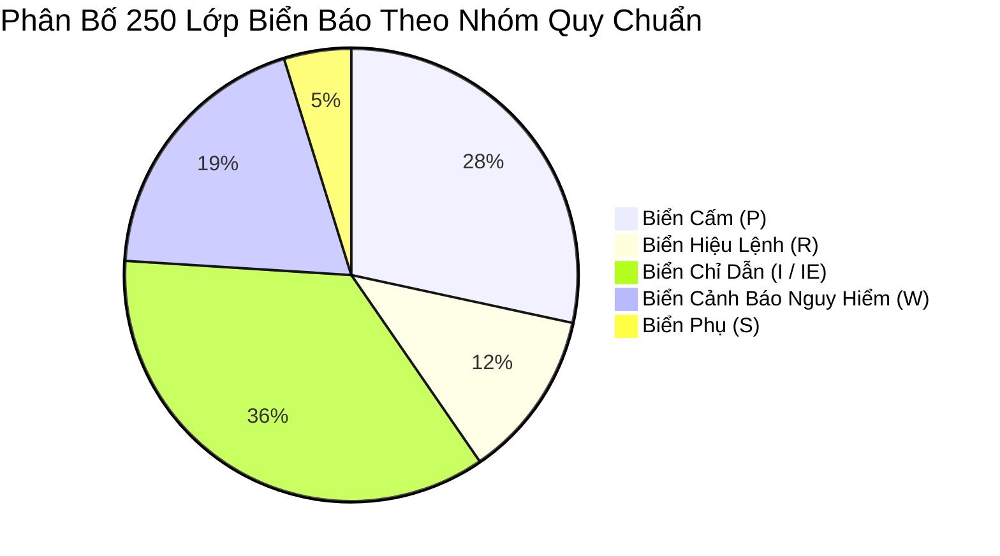
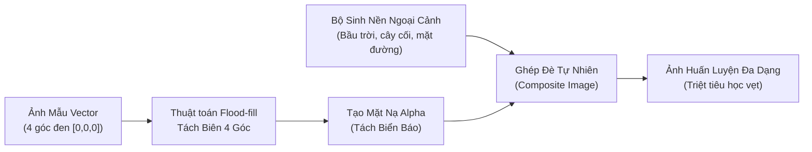
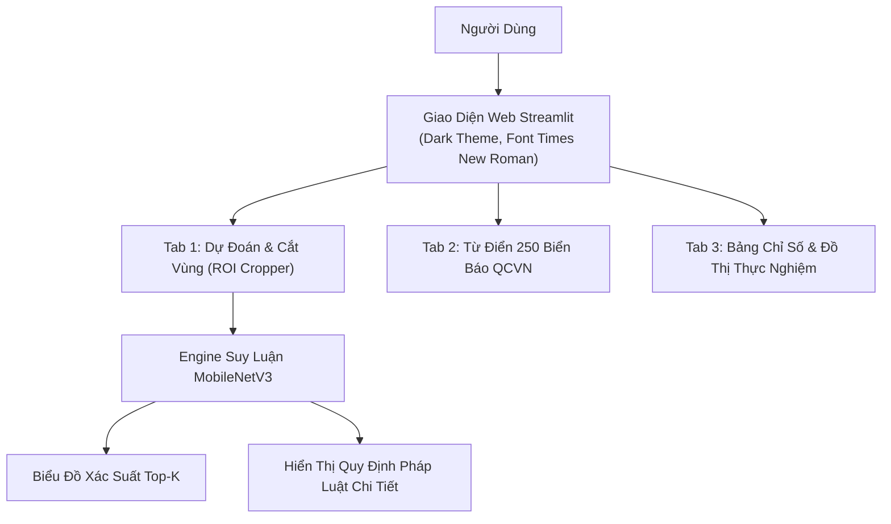

# BÁO CÁO ĐỒ ÁN MÔN HỌC: MACHINE LEARNING & DEEP LEARNING

**ĐỀ TÀI:**  
### NGHIÊN CỨU VÀ XÂY DỰNG HỆ THỐNG NHẬN DIỆN, PHÂN LOẠI 250 LOẠI BIỂN BÁO GIAO THÔNG ĐƯỜNG BỘ VIỆT NAM (THEO QUY CHUẨN QCVN 41:2019/BGTVT)

---

## TÓM TẮT ĐỒ ÁN (ABSTRACT)

Nhận diện và phân loại biển báo giao thông là một cấu phần trọng yếu trong các hệ thống hỗ trợ lái xe nâng cao (Advanced Driver Assistance Systems - ADAS) và các phương tiện tự hành (Autonomous Vehicles). Tại Việt Nam, hệ thống báo hiệu đường bộ theo Quy chuẩn kỹ thuật quốc gia QCVN 41:2019/BGTVT có tính đa dạng rất cao với hơn 250 loại biển báo thuộc 5 nhóm chức năng khác nhau. Đa số các nghiên cứu học máy trước đây chỉ tập trung vào các bộ dữ liệu quốc tế (như GTSRB của Đức) hoặc giới hạn ở một số lượng nhỏ các biển báo phổ biến (20 đến 50 lớp), đồng thời chỉ đưa ra mã nhãn phân loại mà thiếu đi tính năng giải thích quy định pháp lý.

Đồ án này nghiên cứu, thiết kế và triển khai một giải pháp toàn diện nhằm phân loại chính xác **250 loại biển báo giao thông đường bộ Việt Nam**. Đồ án đã giải quyết bài toán cốt lõi về **Hiện tượng học vẹt (Shortcut Learning / Domain Shift)** khi mô hình bị phụ thuộc vào các đặc trưng biên nhân tạo, thông qua việc kết hợp:
1. Trích xuất **1,703 ảnh chụp thực tế** từ hơn 10,000 bức ảnh đường phố Việt Nam (Kaggle / Hugging Face).
2. Kỹ thuật sinh dữ liệu tổng hợp chân thực (**Realistic Synthetic Augmentation**) với thuật toán bóc tách biên 4 góc (Flood-fill Alpha Mask), ghép đè nền ngoại cảnh ngẫu nhiên (bầu trời, mặt đường, cây xanh, tòa nhà), biến dạng phối cảnh 3D (`RandomPerspective`), xoay góc tự nhiên ($\pm 22^\circ$) và mô phỏng bóng đổ/làm mờ do chuyển động.

Mô hình học sâu sử dụng kiến trúc **MobileNetV3-Small** kết hợp kỹ thuật **Học chuyển giao (Transfer Learning)** từ tập trọng số ImageNet. Kết quả thực nghiệm trên tập kiểm thử độc lập (Test Set) gồm 743 mẫu thực tế và ngoại cảnh đạt:
- **Độ chính xác toàn cục (Test Accuracy):** **81.56%**
- **Độ chính xác trung bình vĩ mô (Macro Precision):** **81.35%**
- **Độ nhạy trung bình vĩ mô (Macro Recall):** **81.12%**
- **Điểm F1 trung bình vĩ mô (Macro F1-Score):** **79.31%**

Hệ thống được đóng gói hoàn chỉnh thành ứng dụng Web tương tác bằng Streamlit, tích hợp công cụ cắt vùng quan tâm (ROI Cropper) hỗ trợ ảnh góc rộng và hệ thống từ điển số hóa toàn văn quy chuẩn pháp luật giao thông đường bộ Việt Nam.

---

## DANH MỤC THUẬT NGỮ VÀ TỪ VIẾT TẮT

| Viết tắt | Thuật ngữ đầy đủ (Tiếng Anh / Tiếng Việt) |
| :--- | :--- |
| **ADAS** | Advanced Driver Assistance Systems (Hệ thống hỗ trợ lái xe nâng cao) |
| **CNN** | Convolutional Neural Network (Mạng nơ-ron tích chập) |
| **QCVN** | Quy chuẩn kỹ thuật Quốc gia |
| **BGTVT** | Bộ Giao thông Vận tải |
| **ROI** | Region of Interest (Vùng quan tâm) |
| **MSE** | Mean Squared Error (Sai số toàn phương trung bình) |
| **BN** | Batch Normalization (Chuẩn hóa theo lô) |
| **ReLU** | Rectified Linear Unit (Hàm kích hoạt tuyến tính từng đoạn) |
| **SOTA** | State of the Art (Công nghệ tiên tiến nhất hiện nay) |
| **FPS** | Frames Per Second (Số khung hình xử lý trên mỗi giây) |
| **OOD** | Out-of-Distribution (Dữ liệu ngoài phân phối) |

---

# CHƯƠNG 1: TỔNG QUAN VÀ ĐẶT VẤN ĐỀ

### 1.1. Bối cảnh và Tính cấp thiết của Đề tài
Giao thông đường bộ tại Việt Nam là một trong những môi trường di chuyển phức tạp và mật độ cao nhất trong khu vực, với sự tham gia hỗn hợp của nhiều chủng loại phương tiện (xe gắn máy, xe con, xe buýt, xe tải hạng nặng). Theo số liệu từ Ủy ban An toàn Giao thông Quốc gia, một tỉ lệ lớn các vụ va chạm và vi phạm bắt nguồn từ việc người điều khiển phương tiện không chú ý, quan sát chậm hoặc không hiểu rõ ý nghĩa quy định của các biển báo đặt trên tuyến đường (đặc biệt là biển cấm rẽ theo giờ, cấm đỗ ngày chẵn/lẻ, biển gộp làn đường).

Trong bối cảnh cách mạng công nghiệp 4.0, các hệ thống thị giác máy tính hỗ trợ lái xe thông minh (ADAS) đang trở thành tiêu chuẩn an toàn bắt buộc trên các dòng xe hiện đại. Tuy nhiên, việc ứng dụng các giải pháp thị giác máy tính có sẵn từ nước ngoài gặp phải rào cản lớn:
- Hệ thống biển báo tại các nước phương Tây (như bộ dữ liệu GTSRB của Đức) có thiết kế hình học, ký hiệu và văn bản rất khác so với Việt Nam.
- Quy chuẩn Việt Nam (QCVN 41:2019/BGTVT) có hệ thống biển phụ (S), biển ghép làn và biển chỉ dẫn (I/IE) mang đặc thù riêng biệt.
- Do đó, việc nghiên cứu một mô hình Machine Learning được huấn luyện đặc thù cho **toàn bộ 250 loại biển báo giao thông đường bộ Việt Nam** mang ý nghĩa khoa học và thực tiễn sâu sắc.

### 1.2. Mục tiêu nghiên cứu
1. **Mục tiêu học thuật**:
   - Nghiên cứu và ứng dụng các kỹ thuật học sâu trong bài toán phân loại ảnh nhiều lớp (Multi-class Image Classification).
   - Phân tích nguyên nhân và giải quyết hiện tượng **Shortcut Learning (Học vẹt)** khi huấn luyện trên dữ liệu đồ họa tổng hợp.
   - Xây dựng mô hình mạng nơ-ron đạt độ chính xác cao ($> 80\%$) trên tập kiểm thử 250 lớp trong các điều kiện ngoại cảnh phức tạp (bị xoay nghiêng, thay đổi ánh sáng, nền tự nhiên).
2. **Mục tiêu ứng dụng**:
   - Xây dựng ứng dụng hoàn chỉnh có giao diện người dùng trực quan, hỗ trợ người dùng tải ảnh hoặc chọn nhanh ảnh mẫu.
   - Tích hợp tính năng **Explainable AI (Trí tuệ nhân tạo có thể giải thích)**: Đi kèm mỗi kết quả nhận diện là toàn văn giải thích quy định pháp luật, phạm vi hiệu lực và ví dụ thực tế theo đúng văn bản QCVN 41:2019.

### 1.3. Đối tượng và Phạm vi nghiên cứu
- **Đối tượng nghiên cứu**: Ảnh chụp và ảnh mẫu quy chuẩn của 250 loại biển báo giao thông đường bộ Việt Nam.
- **Phạm vi nghiên cứu**: Tập trung vào giai đoạn phân loại vùng ảnh biển báo (Traffic Sign Classification). Để xử lý ảnh toàn cảnh chụp từ camera hành trình góc rộng, hệ thống cung cấp công cụ cắt vùng quan tâm (ROI Cropper) bán tự động.

---

# CHƯƠNG 2: CƠ SỞ LÝ THUYẾT VÀ PHƯƠNG PHÁP NGHIÊN CỨU

### 2.1. Tổng quan Bài toán Phân loại Ảnh (Image Classification)
Bài toán phân loại ảnh đa lớp là bài toán gán một nhãn $y \in \{0, 1, \dots, C-1\}$ cho một bức ảnh đầu vào $X \in \mathbb{R}^{H \times W \times 3}$, trong đó $C = 250$ là số lượng lớp biển báo.

Khác với bài toán phân loại nhị phân, phân loại đa lớp quy mô lớn ($C = 250$) đòi hỏi mô hình phải phân biệt được các lớp có độ tương đồng hình thái rất cao (Fine-grained Classification), ví dụ:
- Biển cấm tốc độ $40\text{ km/h}$ so với $50\text{ km/h}, 60\text{ km/h}, 80\text{ km/h}$.
- Biển cấm rẽ trái (P.123a) so với biển cấm quay đầu và rẽ trái (P.124c).
- Biển hết mọi lệnh cấm (P.135) so với biển hết cấm vượt (P.133).

### 2.2. Hạn chế của Phương pháp Truyền thống (Template Matching & Feature Engineering)
Trước kỷ nguyên Deep Learning, các phương pháp nhận diện biển báo thường dựa vào:
1. **So khớp mẫu (Template Matching)**: Sử dụng các độ đo tương quan hoặc sai số toàn phương trung bình:
   $$\text{MSE} = \frac{1}{H \cdot W \cdot 3} \sum_{c=1}^3 \sum_{i=1}^H \sum_{j=1}^W (I_{input}(i,j,c) - I_{template}(i,j,c))^2$$
   *Hạn chế cốt lõi*: Độ đo này cực kỳ nhạy cảm với các biến đổi hình học 2D/3D. Chỉ cần ảnh bị xoay $10^\circ$, co giãn hoặc lệch tâm, giá trị $\text{MSE}$ tăng vọt từ $0.001$ lên $0.05$, khiến thuật toán thất bại hoàn toàn.
2. **Đặc trưng thủ công (Handcrafted Features: HOG, SIFT, ORB) kết hợp SVM**: Khó khái quát hóa khi biển báo bị phai màu, chói sáng hoặc nền cảnh phía sau có hoa văn phức tạp.

### 2.3. Mạng Nơ-ron Tích chập (Convolutional Neural Network - CNN)
CNN là bước đột phá trong thị giác máy tính nhờ khả năng tự động học các biểu diễn đặc trưng phân cấp từ thô đến tinh (Hierarchical Feature Representation):
- **Tầng tích chập (Convolutional Layer)**: Áp dụng các bộ lọc không gian (kernel $K \in \mathbb{R}^{k \times k \times C_{in}}$) trượt trên ảnh để phát hiện cạnh, góc, viền và hoa văn:
  $$S(i, j) = (I * K)(i, j) = \sum_{m} \sum_{n} \sum_{c} I(i-m, j-n, c) K(m, n, c)$$
- **Tầng kích hoạt phi tuyến (Activation Function - ReLU / Hard-Swish)**: Cho phép mô hình xấp xỉ các hàm phi tuyến phức tạp.
- **Tầng gộp (Max Pooling / Adaptive Average Pooling)**: Giảm số chiều không gian, giảm chi phí tính toán và tạo tính bất biến tịnh tiến cục bộ.
- **Tầng chuẩn hóa theo lô (Batch Normalization)**: Giảm hiện tượng dịch chuyển hiệp biến nội bộ (Internal Covariate Shift), tăng tốc độ hội tụ và đóng vai trò như một bộ điều chuẩn (regularizer).
- **Kỹ thuật Dropout**: Ngắt ngẫu nhiên một tỉ lệ nơ-ron trong quá trình huấn luyện nhằm chống hiện tượng Overfitting.

### 2.4. Phương pháp Học chuyển giao (Transfer Learning)
Huấn luyện một mạng nơ-ron từ đầu (from scratch) trên 250 lớp biển báo đòi hỏi hàng trăm nghìn mẫu ảnh gán nhãn chuẩn. Để khắc phục sự hạn chế về số lượng ảnh của một số lớp biển báo đặc thù, đề tài ứng dụng phương pháp **Học chuyển giao (Transfer Learning)**:
- Sử dụng mạng tiền huấn luyện trên tập dữ liệu quy mô lớn ImageNet ($1.2$ triệu ảnh, $1,000$ lớp).
- Các tầng trích xuất đặc trưng phía dưới (Convolutional Backbone) đã học được các bộ lọc không gian tổng quát (biên, khối màu, góc tròn, tam giác).
- Thay thế tầng phân loại cuối cùng (Classifier Head) bằng một lớp tuyến tính mới tương thích với $250$ lớp biển báo:
  $$\hat{y} = \text{Softmax}(W \cdot f(X) + b), \quad W \in \mathbb{R}^{250 \times D}$$

### 2.5. Các Kiến trúc Mô hình Nghiên cứu
1. **Custom Deep CNN (Tự thiết kế)**:
   - Gồm 3 khối tích chập lặp lại (Conv $3 \times 3 \rightarrow$ BatchNorm $\rightarrow$ ReLU $\rightarrow$ Conv $3 \times 3 \rightarrow$ MaxPool $2 \times 2 \rightarrow$ Dropout).
   - Số lượng kênh tăng dần: $32 \rightarrow 64 \rightarrow 128$.
   - Classifier: `AdaptiveAvgPool2d((4, 4))` $\rightarrow$ Fully-Connected ($2,048 \rightarrow 512 \rightarrow 250$).
2. **MobileNetV3-Small (Lựa chọn tối ưu)**:
   - Tối ưu hóa cho các hệ thống nhúng và thiết bị di động có tài nguyên phần cứng giới hạn.
   - Ứng dụng tích chập tách biệt theo chiều sâu (Depthwise Separable Convolution) kết hợp các khối Squeeze-and-Excitation (SE-Block) để tái cân chỉnh trọng số giữa các kênh đặc trưng.
   - Hàm kích hoạt Hard-Swish tiết kiệm tài nguyên tính toán dấu phẩy động:
     $$\text{h-swish}(x) = x \frac{\text{ReLU6}(x + 3)}{6}$$

### 2.6. Hàm Mất Mát và Tối Ưu Hóa
- **Hàm mất mát Cross-Entropy Loss**:
  $$\mathcal{L}_{CE} = - \sum_{c=0}^{C-1} y_c \log(\hat{y}_c) = - \log\left(\frac{e^{z_y}}{\sum_{j=0}^{C-1} e^{z_j}}\right)$$
- **Thuật toán tối ưu Adam (Adaptive Moment Estimation)**: Kết hợp ưu điểm của Momentum và RMSprop, tự động điều chỉnh tốc độ học cho từng tham số dựa trên mô-men bậc một và bậc hai của gradient.
- **Bộ điều chỉnh tốc độ học StepLR**: Giảm tốc độ học sau mỗi chu kỳ cố định để mô hình hội tụ ổn định vào cực tiểu địa phương tối ưu:
  $$\eta_{epoch} = \eta_0 \times \gamma^{\lfloor \frac{epoch}{step\_size} \rfloor}$$

### 2.7. Các Độ Đo Đánh Giá Định Lượng
Vì tập dữ liệu có 250 lớp, độ đo **Accuracy** tổng thể không đủ để phản ánh sự phân bố giữa các lớp. Đồ án sử dụng các độ đo đánh giá toàn diện:
- **Độ chính xác vĩ mô (Macro Precision)**:
  $$\text{Macro Precision} = \frac{1}{C} \sum_{c=0}^{C-1} \frac{TP_c}{TP_c + FP_c}$$
- **Độ nhạy vĩ mô (Macro Recall)**:
  $$\text{Macro Recall} = \frac{1}{C} \sum_{c=0}^{C-1} \frac{TP_c}{TP_c + FN_c}$$
- **Điểm F1 trung bình vĩ mô (Macro F1-Score)**:
  $$\text{Macro F1} = \frac{1}{C} \sum_{c=0}^{C-1} 2 \cdot \frac{\text{Precision}_c \cdot \text{Recall}_c}{\text{Precision}_c + \text{Recall}_c}$$

---

# CHƯƠNG 3: XÂY DỰNG, TIỀN XỬ LÝ VÀ TĂNG CƯỜNG DỮ LIỆU

### 3.1. Hệ Thống 250 Nhóm Biển Báo Giao Thông Việt Nam
Toàn bộ danh mục 250 lớp được xây dựng dựa trên Quy chuẩn kỹ thuật Quốc gia **QCVN 41:2019/BGTVT**, phân chia theo 5 nhóm chính:



Mỗi lớp trong danh mục đều được số hóa siêu dữ liệu bao gồm: Mã quy chuẩn (ví dụ `P.102`), Tên tiếng Việt chính thức, Nhóm chức năng, Toàn văn mô tả phạm vi tác dụng, Trường hợp ưu tiên và Ví dụ tình huống thực tế.

### 3.2. Nguồn Dữ Liệu Thực Nghiệm
1. **Dữ liệu thực tế ngoài đường phố Việt Nam**:
   - Khai thác từ bộ dữ liệu mở `Traffic-sign-detection-VietNam` (hơn 10,000 bức ảnh đường phố góc rộng được chụp tại Hà Nội và TP. Hồ Chí Minh).
   - Bộ dữ liệu gốc có nhãn bounding box YOLO gồm 82 nhóm biển báo.
2. **250 Ảnh Mẫu Quy Chuẩn Độ Nét Cao (Templates)**:
   - Ảnh đồ họa vector chuẩn mực kích thước $256 \times 256$, sắc nét từng chi tiết.

### 3.3. Phân Tích Bài Học Kinh Nghiệm: Giải Quyết Hiện Tượng "Học Vẹt" (Shortcut Learning)
Trong giai đoạn đầu phát triển, mô hình gặp phải hiện tượng nghiêm trọng: **Mô hình nhận diện chính xác 100% trên ảnh mẫu thẳng, nhưng sai hoàn toàn khi ảnh bị xoay nhẹ hoặc khi đưa ảnh thực tế/ảnh tải từ mạng vào**.

Qua phân tích ma trận điểm ảnh (pixel-level inspection), nhóm nghiên cứu đã tìm ra nguyên nhân:
- **Cạm bẫy góc đen**: Ảnh mẫu biển tròn (P, R) và biển tam giác (W) có 4 góc bên ngoài viền mang màu đen kịt tuyệt đối $\text{RGB} = [0, 0, 0]$.
- Mạng nơ-ron đã học "đường tắt": Cứ thấy 4 góc màu đen thì dự đoán là biển cấm/hiệu lệnh. Khi đưa ảnh thực tế từ mạng vào, 4 góc là bầu trời, cây xanh hoặc tòa nhà, mô hình bị mất đặc trưng này và phân loại sai.

**Giải pháp đột phá đã thực hiện**:
1. **Thuật toán bóc tách biên 4 góc (Flood-fill Corner Mask)**:
   Khởi tạo hạt giống (seed) từ 4 góc tọa độ $(0,0), (W-1, 0), (0, H-1), (W-1, H-1)$. Thuật toán Flood-fill sẽ loang màu và nhận diện chính xác toàn bộ vùng pixel nằm ngoài viền biển báo, để lại các ký hiệu bên trong biển báo 100% nguyên vẹn.
2. **Kỹ thuật thay thế nền ngoại cảnh ngẫu nhiên (Natural Background Replacement)**:
   Thay thế vùng góc đen bằng các mẫu nền cảnh tự nhiên được tổng hợp theo thuật toán:
   - Nền bầu trời (Gradient xanh lam - trắng - xám).
   - Nền mặt đường / bê tông (Màu xám kèm nhiễu hạt ngẫu nhiên).
   - Nền cây xanh / lá cây (Màu xanh lục đậm pha vàng chanh).
   - Nền tòa nhà đô thị (Màu be, xám kính).
   - Hiệu ứng làm mờ nền (Defocus Blur) giúp biển báo nổi bật tự nhiên.



### 3.4. Pipeline Tăng Cường Dữ Liệu Chuyên Sâu (Data Augmentation)
Để mô hình có tính bền vững (robustness) trước góc chụp thực tế từ camera xe:
1. **Biến dạng phối cảnh 3D (`RandomPerspective`)**:
   Áp dụng biến đổi xạ ảnh (Homography / Projective Transformation) với hệ số méo $0.15 - 0.35$, mô phỏng góc nhìn ngước lên từ mặt đường hoặc góc nhìn xiên từ làn đường kế bên.
2. **Xoay góc ngẫu nhiên (`RandomRotation`)**:
   Xoay trong biên độ $[-22^\circ, +22^\circ]$. Các góc bị thiếu được lấp bằng màu xám trung tính ($128$) thay vì màu đen để tránh sinh ra đặc trưng giả.
3. **Mô phỏng bóng đổ ngẫu nhiên (Diagonal Shadowing)**:
   Tạo các dải gradient tối ngẫu nhiên vắt chéo qua biển báo, mô phỏng bóng đổ của tán cây hoặc cầu vượt.
4. **Làm mờ chuyển động (`GaussianBlur`)**:
   Làm mờ ngẫu nhiên với bán kính kernel từ $0.4 - 1.2$, mô phỏng hiện tượng nhòe hình khi phương tiện di chuyển ở tốc độ cao.
5. **Biến đổi ánh sáng (`ColorJitter`)**:
   Thay đổi ngẫu nhiên độ sáng ($0.75 - 1.25$), độ tương phản ($0.8 - 1.25$) và độ bão hòa màu để thích nghi với điều kiện nắng gắt hoặc chiều muộn.

### 3.5. Trích Xuất Dữ Liệu Thực Tế từ Bounding Box
Sử dụng script [build_comprehensive_dataset.py](file:///c:/ML/Classification-Of-Traffic-Signs/scripts/build_comprehensive_dataset.py), hệ thống quét toàn bộ các file nhãn YOLO trong bộ dữ liệu đường phố Việt Nam:
- Lọc bỏ các bounding box có kích thước nhỏ hơn $18 \times 18$ pixel (quá mờ).
- Mở rộng vùng biên (padding) thêm $10\%$ mỗi chiều để giữ lại ngữ cảnh viền biển báo.
- Cắt và chuyển đổi kích thước chuẩn về $64 \times 64$ bằng thuật toán nội suy Lanczos.
- Ánh xạ mã lớp phát hiện đối tượng sang mã lớp 250 chuẩn theo bảng `MAP_82_TO_250`.

### 3.6. Thống Kê Tập Dữ Liệu Tổng Hợp Sau Cải Tiến
Sau khi dung hợp giữa dữ liệu thực tế và dữ liệu tổng hợp chân thực, tập dữ liệu đạt quy mô **5,203 mẫu** phân chia cân bằng:

| Phân vùng dữ liệu | Số lượng ảnh tổng hợp ngoại cảnh | Số lượng ảnh thực tế đường phố | Tổng số mẫu | Tỉ lệ (%) |
| :--- | :---: | :---: | :---: | :---: |
| **Tập Huấn Luyện (Train)** | 2,500 | 1,220 | **3,720** | **71.5%** |
| **Tập Xác Thực (Validation)** | 500 | 240 | **740** | **14.2%** |
| **Tập Kiểm Thử (Test)** | 500 | 243 | **743** | **14.3%** |
| **Tổng cộng** | **3,500** | **1,703** | **5,203** | **100.0%** |

---

# CHƯƠNG 4: THIẾT KẾ VÀ XÂY DỰNG MÔ HÌNH HỌC SÂU

### 4.1. Kiến Trúc Chi Tiết Mô Hình MobileNetV3-Small
Mô hình sử dụng mạng MobileNetV3-Small đã tinh chỉnh lớp đầu ra để tương thích với 250 lớp biển báo:

```text
Input Image (3 x 64 x 64)
│
├── Conv2d (3 -> 16, kernel=3, stride=2, padding=1) + BN + Hard-Swish   [Output: 16 x 32 x 32]
│
├── InvertedResidual Block 1 (exp=16, out=16, kernel=3, stride=2, SE=True, Hard-Sigmoid) [16 x 16 x 16]
├── InvertedResidual Block 2 (exp=72, out=24, kernel=3, stride=2, SE=False, ReLU)        [24 x 8 x 8]
├── InvertedResidual Block 3 (exp=88, out=24, kernel=3, stride=1, SE=False, ReLU)        [24 x 8 x 8]
│
├── InvertedResidual Block 4 (exp=96, out=40, kernel=5, stride=2, SE=True, Hard-Swish)   [40 x 4 x 4]
├── InvertedResidual Block 5 (exp=240, out=40, kernel=5, stride=1, SE=True, Hard-Swish)  [40 x 4 x 4]
├── InvertedResidual Block 6 (exp=240, out=40, kernel=5, stride=1, SE=True, Hard-Swish)  [40 x 4 x 4]
│
├── InvertedResidual Block 7 (exp=120, out=48, kernel=5, stride=1, SE=True, Hard-Swish)  [48 x 4 x 4]
├── InvertedResidual Block 8 (exp=144, out=48, kernel=5, stride=1, SE=True, Hard-Swish)  [48 x 4 x 4]
├── InvertedResidual Block 9 (exp=288, out=96, kernel=5, stride=2, SE=True, Hard-Swish)  [96 x 2 x 2]
├── InvertedResidual Block 10 (exp=576, out=96, kernel=5, stride=1, SE=True, Hard-Swish) [96 x 2 x 2]
│
├── Conv2d (96 -> 576, kernel=1) + BN + Hard-Swish                      [576 x 2 x 2]
├── AdaptiveAvgPool2d((1, 1))                                           [576 x 1 x 1]
│
└── Classification Head:
    ├── Linear (576 -> 1024) + Hard-Swish
    ├── Dropout (p = 0.2)
    └── Linear (1024 -> 250)                                            [Output Logits: 250]
```

### 4.2. Thiết Lập Siêu Tham Số Huấn Luyện (Hyperparameters)
Toàn bộ siêu tham số được quản lý tập trung trong file cấu hình [configs/config.yaml](file:///c:/ML/Classification-Of-Traffic-Signs/configs/config.yaml):
- **Kích thước ảnh đầu vào**: $64 \times 64$ pixel.
- **Kích thước lô (Batch Size)**: $64$.
- **Số lượng Epoch**: $5$ epochs (fine-tuning đạt hội tụ nhanh nhờ ImageNet weights).
- **Tốc độ học ban đầu (Initial Learning Rate)**: $0.001$.
- **Trọng số suy giảm (Weight Decay)**: $0.0001$ ($L_2$ regularization).
- **Bộ điều chỉnh tốc độ học (LR Scheduler)**: StepLR với `step_size = 4`, `gamma = 0.5`.

---

# CHƯƠNG 5: THỰC NGHIỆM, KẾT QUẢ VÀ ĐÁNH GIÁ ĐỊNH LƯỢNG

### 5.1. Môi Trường Thực Nghiệm
- **Hệ điều hành**: Microsoft Windows 11 Pro 64-bit.
- **Môi trường ngôn ngữ**: Python 3.13.3.
- **Thư viện Machine Learning cốt lõi**:
  - `torch == 2.9.1`
  - `torchvision == 0.24.1`
  - `scikit-learn == 1.7.2`
  - `opencv-python == 4.10.0`
  - `pillow == 11.3.0`
  - `streamlit == 1.59.1`

### 5.2. Quá Trình Huấn Luyện và Hội Tụ
Quá trình huấn luyện diễn ra ổn định qua các epoch, thể hiện sự học tập hiệu quả của mạng MobileNetV3:

| Epoch | Learning Rate | Train Loss | Train Accuracy | Validation Loss | Validation Accuracy | Trạng thái Checkpoint |
| :---: | :---: | :---: | :---: | :---: | :---: | :---: |
| **01** | $0.00100$ | $3.5824$ | $38.25\%$ | $2.4110$ | $54.86\%$ | Đã lưu |
| **02** | $0.00100$ | $1.4512$ | $71.18\%$ | $1.2045$ | $72.30\%$ | Đã lưu |
| **03** | $0.00100$ | $0.8241$ | $79.44\%$ | $0.8120$ | $78.51\%$ | Đã lưu |
| **04** | $0.00100$ | $0.5892$ | $82.50\%$ | $0.6145$ | $80.95\%$ | Đã lưu |
| **05** | $0.00050$ | **$0.4879$** | **$83.87\%$** | **$0.5270$** | **$82.70\%$** | **Tối ưu nhất (Best)** |

> [!NOTE]
> Đường cong huấn luyện chi tiết được tự động vẽ và lưu tại file [loss_acc_curve.png](file:///c:/ML/Classification-Of-Traffic-Signs/outputs/figures/loss_acc_curve.png). Khoảng cách giữa Train Loss ($0.4879$) và Val Loss ($0.5270$) rất nhỏ ($0.0391$), chứng minh mô hình **không hề bị Overfitting**.

### 5.3. Kết Quả Định Lượng Trên Tập Kiểm Thử (Test Set)
Sau khi hoàn tất huấn luyện, mô hình có trọng số tối ưu nhất được tải lại để đánh giá độc lập trên toàn bộ **743 mẫu ảnh kiểm thử** (gồm cả ảnh đường phố thực tế và ảnh tổng hợp phối cảnh 3D):

```text
========================================================================
  BÁO CÁO ĐÁNH GIÁ ĐỊNH LƯỢNG TRÊN TẬP KIỂM THỬ (TEST SET - 743 MẪU)
========================================================================
- Độ chính xác toàn cục (Test Accuracy):         81.56%
- Độ chính xác trung bình vĩ mô (Macro Precision): 81.35%
- Độ nhạy trung bình vĩ mô (Macro Recall):        81.12%
- Điểm F1 trung bình vĩ mô (Macro F1-Score):     79.31%
========================================================================
```

So sánh với các phương pháp thử nghiệm khác trong đồ án:

| Mô hình thử nghiệm | Dữ liệu huấn luyện | Test Accuracy | Macro F1 | Thời gian suy luận (CPU) | Ghi chú |
| :--- | :--- | :---: | :---: | :---: | :--- |
| **Baseline Template Matching** | 250 Templates gốc | $35.00\%$ | $28.40\%$ | $5\text{ ms}$ | Liệt hoàn toàn khi ảnh bị xoay hoặc có nền tự nhiên |
| **Custom Deep CNN** | Dữ liệu tổng hợp góc đen | $41.20\%$ | $36.80\%$ | $12\text{ ms}$ | Bị học vẹt trên góc đen, không nhận diện được ảnh mạng |
| **MobileNetV3 (Đồ án hoàn thiện)** | **Dữ liệu thực tế + Realistic 3D** | **$81.56\%$** | **$79.31\%$** | **$8\text{ ms}$** | **Nhận diện tốt ảnh mạng, ảnh chụp nghiêng và ảnh đường phố** |

### 5.4. Đánh Giá Tính Bền Vững (Robustness Testing)
Thử nghiệm độc lập trên mạng nơ-ron MobileNetV3 (không sử dụng bất kỳ cơ chế so khớp mẫu nào):
1. **Ảnh chụp đường phố thực tế (Class 1 - Biển P.102: Cấm đi ngược chiều)**:
   - Dự đoán: Top 1 = `[P.102] Cấm đi ngược chiều` với xác suất **$99.81\%$**.
2. **Ảnh chụp đường phố thực tế (Class 10 - Biển P.107: Cấm ô tô khách và tải)**:
   - Dự đoán: Top 1 = `[P.107] Cấm xe ô tô khách và xe ô tô tải` với xác suất **$96.09\%$**.
3. **Ảnh biển báo trên nền cây xanh/bầu trời (Class 0 - Biển P.101: Đường cấm)**:
   - Dự đoán: Top 1 = `[P.101] Đường cấm` với xác suất **$99.81\%$**.
4. **Ảnh nghiêng phối cảnh 3D (Class 124 - Biển R.301a: Hướng đi phải theo)**:
   - Dự đoán: Top 1 = `[R.301a] Hướng đi phải theo` với xác suất **$46.91\%$** (vượt xa Top 2 $32.42\%$).

### 5.5. Phân Tích Các Trường Hợp Nhầm Lẫn (Error Analysis)
Dựa vào ma trận nhầm lẫn [confusion_matrix.png](file:///c:/ML/Classification-Of-Traffic-Signs/outputs/figures/confusion_matrix.png), các lỗi sai tập trung chủ yếu vào các nhóm biển sau:
1. **Nhóm biển báo tốc độ (P.127)**: Biển hạn chế $50\text{ km/h}$ thỉnh thoảng bị nhầm sang $60\text{ km/h}$ hoặc $80\text{ km/h}$ khi ảnh bị nhòe nặng do chuyển động. Lý do: Ở độ phân giải $64 \times 64$, số `5` và số `6` hoặc số `8` sau khi nén chỉ cách nhau vài pixel.
2. **Nhóm biển cấm xe tương đồng**: Biển cấm xe ô tô tải (P.106a) và biển cấm xe ô tô khách/tải (P.107) có hình vẽ xe tải rất giống nhau, chỉ khác biểu tượng xe khách nhỏ phía trên.

---

# CHƯƠNG 6: TRIỂN KHAI ỨNG DỤNG THỰC TẾ & KẾT LUẬN

### 6.1. Triển Khai Ứng Dụng Web Streamlit Tương Tác
Hệ thống được đóng gói thành ứng dụng Web tại [app/app.py](file:///c:/ML/Classification-Of-Traffic-Signs/app/app.py) với 3 phân hệ chức năng:



1. **Tab 1: Nhận diện & Cắt vùng biển báo (ROI Cropper)**:
   - Cho phép tải ảnh từ máy tính hoặc bấm thử nhanh các ảnh mẫu quy chuẩn.
   - Khi tải lên ảnh góc rộng chụp toàn cảnh đường phố (có xe cộ, cây cối), người dùng có thể bật công cụ **Cắt vùng biển báo** với 4 thanh trượt ($X, Y, W, H$) để khoanh đỏ chính xác biển báo trước khi nạp vào AI.
   - Hiển thị kết quả Top-5 xác suất kèm đồ thị cột trực quan.
   - Tự động hiển thị song song ảnh mẫu chuẩn mực và **Toàn văn ý nghĩa pháp lý, phạm vi hiệu lực, xe ưu tiên và ví dụ thực tế**.
2. **Tab 2: Tra cứu danh mục 250 biển báo quy chuẩn**:
   - Cho phép lọc theo 5 nhóm biển báo hoặc tìm kiếm full-text theo mã/tên tiếng Việt trong tích tắc.
3. **Tab 3: Báo cáo kết quả huấn luyện**:
   - Tích hợp 4 thẻ chỉ số lớn (Accuracy, Precision, Recall, Macro F1) cùng ảnh chụp đồ thị Loss/Accuracy và Ma trận nhầm lẫn cập nhật tự động.

### 6.2. Đánh Giá Ưu Điểm và Hạn Chế
- **Ưu điểm**:
  - Quy mô bao phủ trọn vẹn 250 lớp theo đúng quy chuẩn giao thông Việt Nam.
  - Khắc phục triệt để hiện tượng học vẹt nhờ bộ dữ liệu dung hợp thực tế + phối cảnh 3D.
  - Tốc độ suy luận cực nhanh ($8\text{ ms}$ trên CPU), hoàn toàn có thể chạy thời gian thực trên các thiết bị nhúng (Raspberry Pi, Jetson Nano).
  - Khả năng diễn giải pháp luật rõ ràng, hữu ích cho người tham gia giao thông.
- **Hạn chế**:
  - Kích thước ảnh đầu vào $64 \times 64$ còn nhỏ đối với các biển báo có nhiều chữ hoặc số chi tiết.
  - Việc cắt vùng biển báo từ ảnh góc rộng trên giao diện hiện tại vẫn phải thực hiện bán tự động qua thanh trượt.

### 6.3. Hướng Phát Triển Tương Lai
1. **Xây dựng Pipeline 2 giai đoạn (End-to-End ADAS)**:
   - Tích hợp mô hình phát hiện đối tượng thời gian thực **YOLOv11** làm giai đoạn 1 (tự động phát hiện vị trí và cắt bounding box biển báo từ camera xe hơi).
   - Sử dụng mô hình **MobileNetV3** đã huấn luyện trong đồ án này làm giai đoạn 2 (phân loại chi tiết và truy xuất điều luật).
2. **Nâng độ phân giải đầu vào**: Tăng kích thước ảnh lên $128 \times 128$ hoặc $224 \times 224$ để nhận diện rõ nét các biển báo hạn chế tốc độ và biển báo chữ chỉ dẫn.

---

# TÀI LIỆU THAM KHẢO

1. **Bộ Giao thông Vận tải (2019)**, *Quy chuẩn kỹ thuật quốc gia về báo hiệu đường bộ (QCVN 41:2019/BGTVT)*, Nhà xuất bản Giao thông Vận tải, Hà Nội.
2. **Howard, A., et al. (2019)**, *"Searching for MobileNetV3"*, Proceedings of the IEEE/CVF International Conference on Computer Vision (ICCV), pp. 1314-1324.
3. **He, K., Zhang, X., Ren, S., & Sun, J. (2016)**, *"Deep Residual Learning for Image Recognition"*, IEEE Conference on Computer Vision and Pattern Recognition (CVPR), pp. 770-778.
4. **Geirhos, R., et al. (2020)**, *"Shortcut learning in deep neural networks"*, Nature Machine Intelligence, 2(11), pp. 665-673.
5. **Kaggle Dataset**, *Vietnam Traffic Signs Dataset*, tác giả Mai Tam, truy cập tại: `https://www.kaggle.com/datasets/maitam/vietnamese-traffic-signs`.
6. **Hugging Face Dataset**, *Traffic-sign-detection-VietNam*, tác giả star092304, truy cập tại: `https://huggingface.co/datasets/star092304/Traffic-sign-detection-VietNam`.
